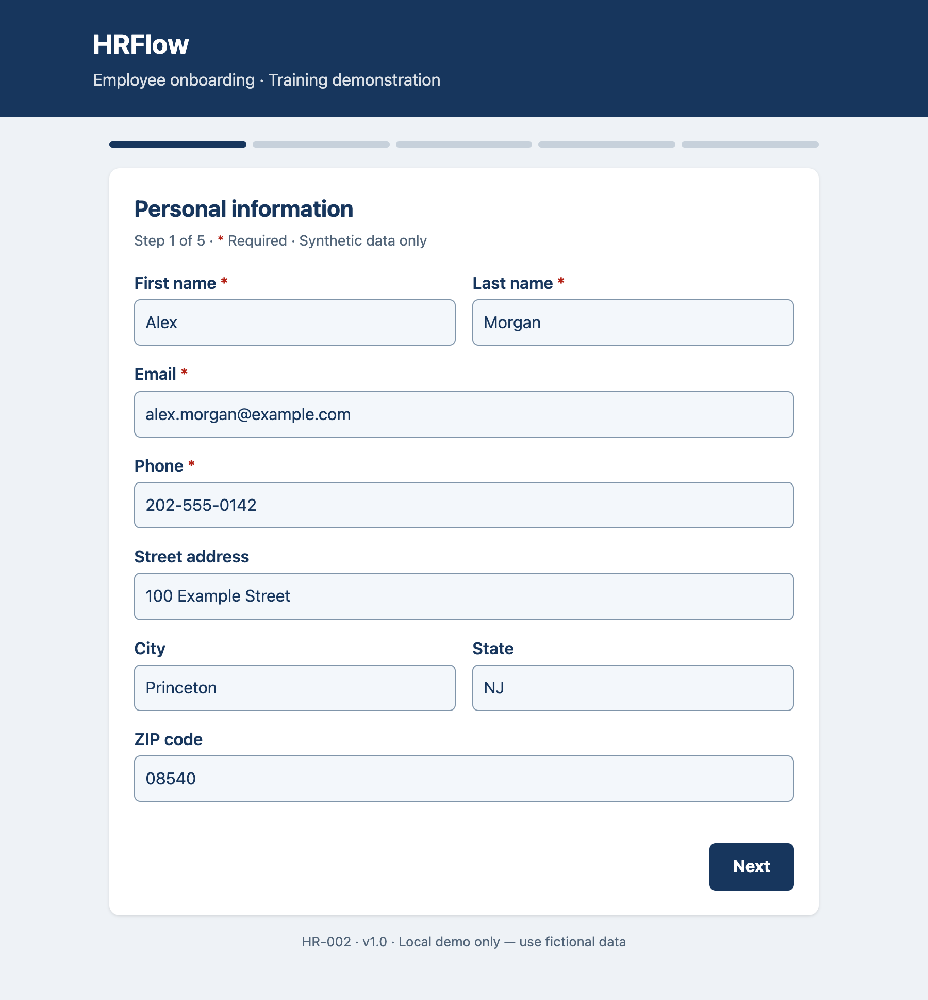
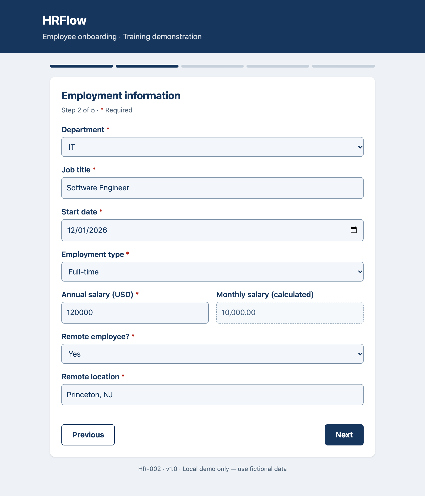
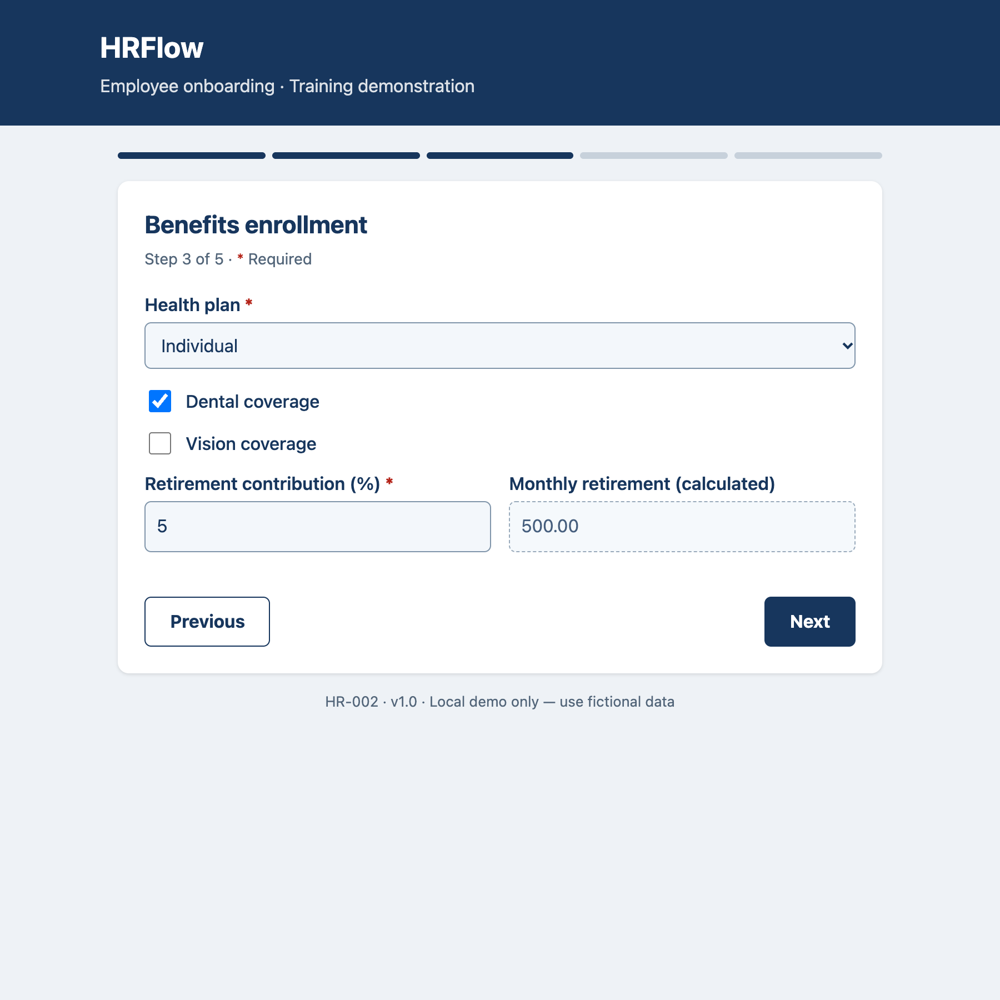
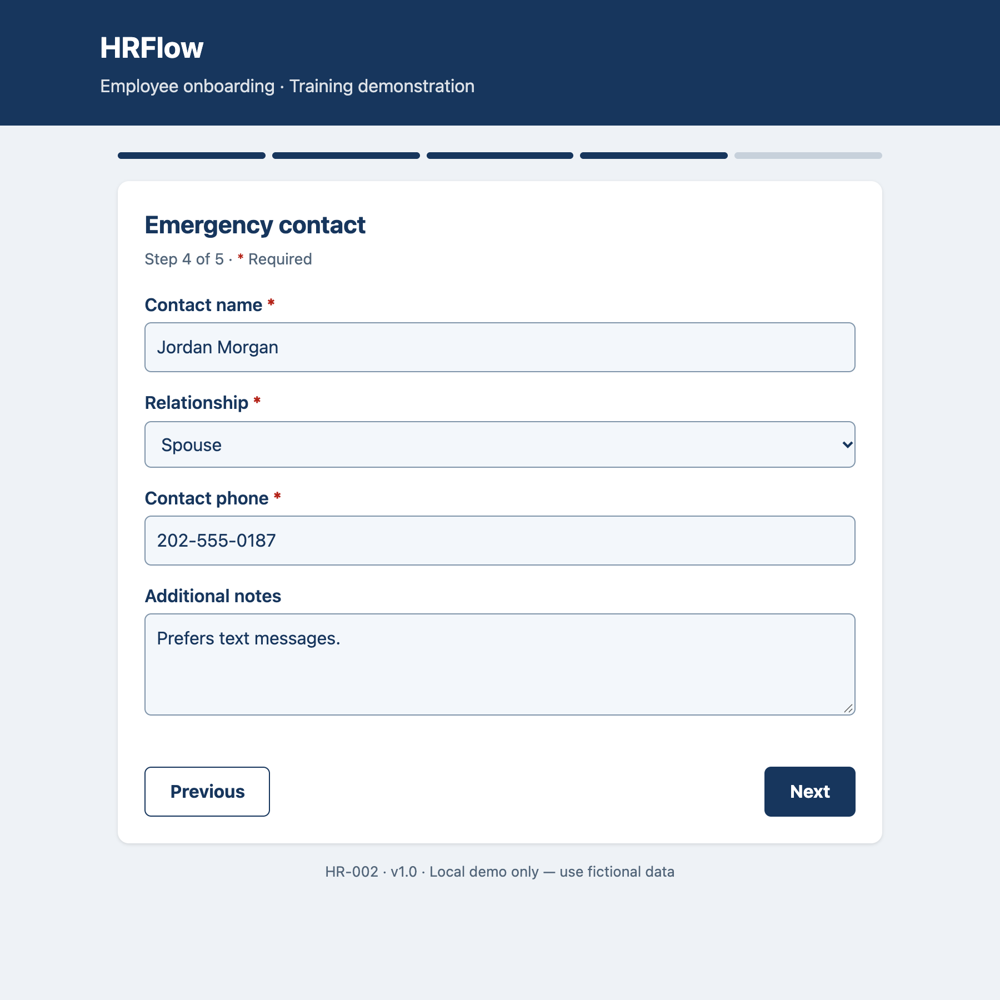
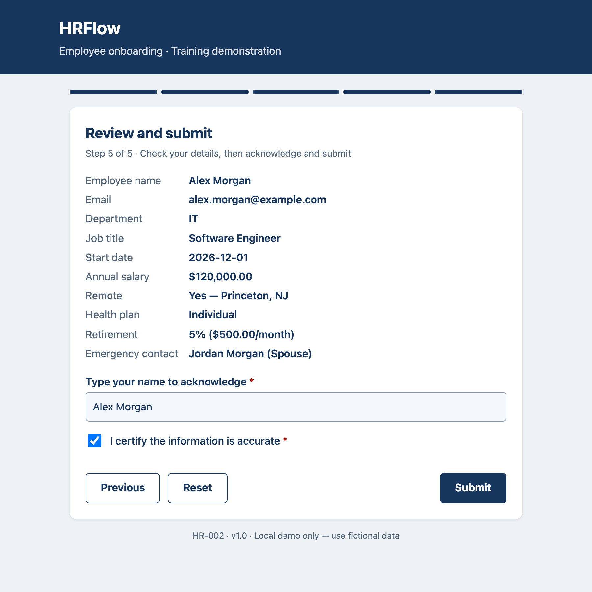

# HRFlow — Adobe Multi-Page Forms

A five-page interactive AcroForm portfolio demonstration for employee onboarding. Not a government system or production HR product. Use fictional data only.

## Architecture

Adobe Acrobat PDF → embedded Acrobat JavaScript → HTTP POST /submit → FastAPI/Pydantic → PostgreSQL (four tables in one transaction). Docker Compose runs the API and database locally. No AEM or LiveCycle server required.

A browser version of the same five-page form is served by the API at http://127.0.0.1:8000/form. It posts to the same `/submit` endpoint, so you can try the full flow without Acrobat.

## Pages

1. Personal information: names, email, phone, address.
2. Employment: department, title, ISO start date, employment type, salary, remote work. Monthly salary calculated; remote location conditionally required.
3. Benefits: health plan, dental, vision, retirement percentage and calculated monthly contribution.
4. Emergency contact: name, relationship, phone, notes.
5. Review: calculated summary, typed acknowledgment, checkbox, submit and reset.

## Screenshots (web version)

| | |
|---|---|
|  |  |
|  |  |
|  | |

## Quick start (Mac)

Install Docker Desktop, Adobe Acrobat desktop (Pro for editing), Python 3.12+ and Git. Node 22 is needed only for JS tests.

```sh
cp .env.example .env
docker compose up --build -d
docker compose ps
curl http://127.0.0.1:8000/health
```

Web form: open http://127.0.0.1:8000/form in any browser, fill the five pages and submit.

Open `forms/employee-onboarding.pdf` in Acrobat desktop, not Preview or a browser. Fill pages 1–5 using Next/Previous. Use a fictional email, e.g. john@example.com. Select IT, Full-time, 2026-12-01, salary 120000, remote Yes and a fictional location. Choose Individual, retirement 5, emergency contact and acknowledgment. Expected calculations: 10000 monthly salary and 500 monthly retirement. Click Submit and approve only the trusted local endpoint if Acrobat prompts. A JSON response may open separately depending on Acrobat version. Verify the database rather than assuming submission succeeded.

```sh
docker compose exec db psql -U hrflow -d hrflow -c 'SELECT e.id,e.first_name,e.last_name,j.department,j.annual_salary,b.health_plan,c.contact_name FROM employees e JOIN employment j ON e.id=j.employee_id JOIN benefits b ON e.id=b.employee_id JOIN emergency_contacts c ON e.id=c.employee_id;'
```

If PDF submission is blocked by viewer security, test the API independently:

```sh
curl -i http://127.0.0.1:8000/submit \
 -d first_name=John -d last_name=Smith -d email=john2@example.com \
 -d phone=202-555-0100 -d department=IT -d job_title=Engineer \
 -d start_date=2026-12-01 -d employment_type=Full-time -d annual_salary=120000 \
 -d remote_employee=Yes -d remote_location=NJ -d health_plan=Individual \
 -d dental=Yes -d vision=Off -d retirement_percent=5 \
 -d emergency_name=Jane -d emergency_relationship=Spouse -d emergency_phone=202-555-0101 \
 -d acknowledged=Yes -d 'employee_name=John Smith'
```

Expected HTTP 201 and employee_id. Duplicate email returns 409; invalid data 422. Database failure returns 503. API docs: http://127.0.0.1:8000/docs (raw form endpoint; use curl for inputs).

## Learn Adobe authoring

Open PDF in Acrobat Pro → All tools → Prepare a form. Inspect field names, tooltips, required flags, dropdown export values and read-only calculated fields. Inspect Next/Previous and Submit button Actions (Mouse Up). Inspect document-level JavaScripts, remote_employee Validate action and calculation fields. Edit `javascript/document.js` and regenerate, or edit scripts in Acrobat and save a separate copy. Acrobat pageNum is zero-based. Navigation validates each page; final submit validates all pages even if the user skipped using viewer controls. Server validates again. Typed acknowledgment is not a digital signature.

## Regenerate and test

```sh
python3 -m venv .venv
source .venv/bin/activate
pip install -r requirements-dev.txt
python scripts/build_form.py
python -m pytest -q
node tests/test_js.js
```

Generator uses ReportLab for layout and pypdf for JavaScript, push-button widgets and calculation order. Source of truth is the generator plus document.js. Tests inspect PDF fields/actions and mock database persistence to test HTTP validation. Node tests use mock Acrobat objects, not the actual Acrobat runtime. CI repeats these checks on push. Real PostgreSQL and Acrobat submission require the local smoke test above.

## Accessibility and security

See docs/accessibility-checklist.md. PDF includes field tooltips and English language metadata but is not fully tagged or certified Section 508 compliant. Test and remediate in Acrobat Pro. JAWS requires Windows; VoiceOver on Mac is an initial check. Local HTTP only; production requires HTTPS, authentication, authorization, audit logging, data retention and privacy controls. No actual payroll or benefits rules. The static remote-location label remains visible when the field is hidden. Browser viewers may ignore Acrobat JavaScript. Do not disable global Acrobat security settings. Never commit filled PDFs, real employee data or .env.

## Stop

`docker compose down` preserves database data. `docker compose down -v` deletes the demo database. Schema initialization runs on first database creation only.
